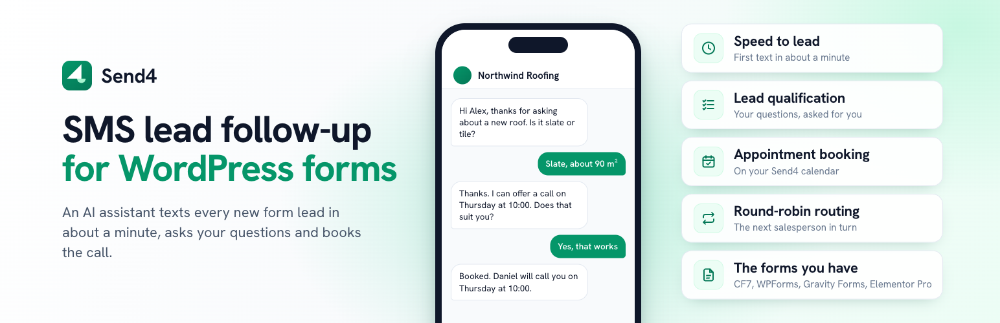
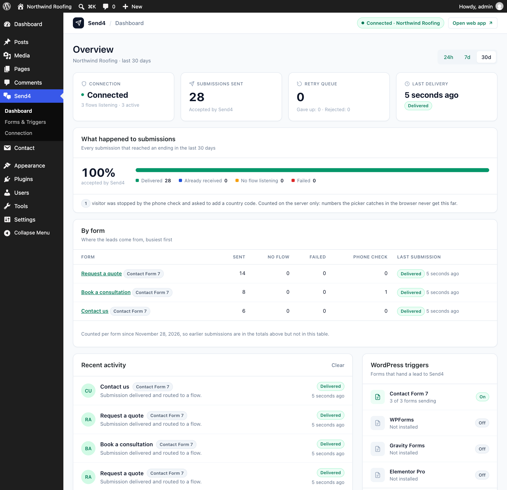

<a href="https://wordpress.org/plugins/send4/"></a>

# Send4 for WordPress

[](https://wordpress.org/plugins/send4/)
[](https://wordpress.org/plugins/send4/)
[](https://wordpress.org/plugins/send4/)
[](https://github.com/Send4ai/send4-wordpress/actions/workflows/ci.yml)
[](LICENSE)

Send4 texts every new lead from your WordPress forms within seconds. When someone submits a
Contact Form 7, WPForms, Gravity Forms or Elementor Pro form, this plugin hands the submission to
your [Send4](https://send4.ai) account, and the AI flow you set up there starts an SMS conversation
with that person: it answers their questions, asks what you need to know, and can book a call.

- **No code.** Connect with one button, pick the field that holds the phone number, turn the form on.
- **No lost leads.** If Send4 cannot be reached, the submission waits in a queue on your site and is
  retried for about a day and a half.
- **Context included.** Every field you do not map is passed along, so the AI knows what the person
  asked for.
- **Nothing hidden.** The dashboard shows, per form, whether the last submission arrived and whether
  a Send4 flow is listening for it.
- **Numbers that can be texted.** Optionally adds a country picker to the phone field, and refuses a
  number with no country code while the visitor is still on the form.



Send4 is a paid service, and this plugin is the WordPress half of it: you need a Send4 account and a
number to text from. [What it does for your site](https://send4.ai/integrations/wordpress).

## Install

In wp-admin, go to **Plugins → Add New Plugin**, search for **Send4**, then install and activate it.
Or, with WP-CLI:

```bash
wp plugin install send4 --activate
```

The plugin's page in the directory is <https://wordpress.org/plugins/send4/>. Each
[GitHub release](https://github.com/Send4ai/send4-wordpress/releases/latest) carries the same
`send4.zip`, for a manual upload.

It needs WordPress 6.2 or later, PHP 7.4 or later, and at least one of the form plugins below.

## Set up

1. Go to **Send4 → Connection** and press **Connect with Send4**. Approve the connection in Send4;
   you are brought back to WordPress and see "Connected to *your account*".
2. Go to **Send4 → Forms & Triggers**, choose a form, pick the field that holds the phone number,
   and enable it.
3. In Send4, create a flow whose trigger is **WordPress form** and tick the forms it should listen
   for. They are listed by name, because the plugin reports them.

Prefer to paste a key? Create an API key in Send4 with the **WordPress plugin** permission and paste
the client ID and secret on the Connection screen instead. Use one key per website: Send4 binds a
key to the site it was created for and refuses submissions that arrive from anywhere else.

## Supported form plugins

| Form plugin | Notes |
|---|---|
| Contact Form 7 | |
| WPForms, including Lite | A field that already has WPForms Pro's Smart phone picker keeps it; Send4 does not add a second one. |
| Gravity Forms | Set the phone field's format to **International** to get the picker and the country-code check. |
| Elementor Pro | A popup that Elementor loads over AJAX after the page has loaded needs the [`send4_phone_targets`](#hooks) filter to get the picker. |

Using another form plugin? [Open an issue](https://github.com/Send4ai/send4-wordpress/issues/new/choose).
Each one is a single adapter class; see [Adding a form plugin](#adding-a-form-plugin).

## What leaves your site

Nothing is sent until you start connecting the site to Send4, and no visitor's submission is sent
until you also enable a form. After that:

- **Submissions** on the forms you enabled: the phone number, name and email you mapped, the
  remaining fields, the form's name and key, your site URL, and a random submission identifier.
- **A description of your forms**: each form's name and key, whether it is enabled, and each
  field's label and type. Never a submitted value. This is what lets you pick your forms from a
  list in Send4's flow builder.
- **Which versions the site runs**: this plugin, WordPress, PHP and WooCommerce if present, the
  site's language, and whether it is a multisite network.

Everything goes to `https://app.send4.ai` over HTTPS. The full list, with when each request is
made, is under **External services** in [`readme.txt`](readme.txt), which is also what the
WordPress.org listing shows. Send4's [terms](https://send4.ai/terms) and
[privacy policy](https://send4.ai/privacy) apply.

The submissions you forward contain personal data about your visitors. Your form needs a clear
consent line saying that submitting it means Send4 may text them, and your privacy policy should
name Send4 as a processor.

## How it works

The plugin is a thin client: it holds no business logic beyond mapping fields and not losing
submissions.

```
form plugin hooks ──► Normalizer ──► Delivery (sync POST, 3s) ──► Send4
                          ▲                     │
             per-form field mapping             └─► retry queue (WP-Cron, ~1.5 days)

     adapters ──► Form descriptors ──► Forms sync (PUT, on change + daily) ──► Send4
```

- **The visitor never waits more than three seconds.** If Send4 has not answered by then, the
  submission is stored in a table in your database and the visitor sees their normal confirmation.
- **Retries back off**: after a minute, five minutes, fifteen, an hour, then every six hours, for
  about a day and a half in total.
- **A lead is never delivered twice.** Retries reuse the same submission identifier, and an
  identical submission within 60 seconds counts as a repeat.
- **Deactivating keeps the queue and the connection; uninstalling removes them**, along with every
  option the plugin created. The queue can hold lead data, so it does not outlive the plugin.

## WP-CLI

| Command | What it does |
|---|---|
| `wp send4 status` | Prints a one-screen summary of the plugin's state. |
| `wp send4 connect --client-id=<id> --client-secret=<secret>` | Verifies API credentials against Send4, then stores them. Pass `-` as the secret to read it from STDIN. |
| `wp send4 handshake` | Runs the connection test and prints the flows listening for WordPress forms. |
| `wp send4 forms` | Lists the forms Send4 can see on this site. |
| `wp send4 enable <form_key> --phone=<field> [--name=<field>] [--email=<field>]` | Maps a form's fields and starts sending it to Send4. |
| `wp send4 disable <form_key>` | Stops sending a form to Send4. |
| `wp send4 sync_forms [--force]` | Reports this site's detected forms to Send4. |
| `wp send4 queue` | Shows what is waiting in the retry queue. |
| `wp send4 run_queue` | Attempts every queued submission that is due. |
| `wp send4 requeue` | Puts failed submissions back on the queue. |

A form key is the form plugin's slug and the form's id, as in `contact-form-7:42`.

## Hooks

All of these are filters.

| Filter | What it changes | Arguments |
|---|---|---|
| `send4_envelope` | The payload for one submission, just before it is queued or sent. | `$envelope`, `$submission`, `$mapping` |
| `send4_form_adapters` | The list of form plugin adapters. | `$adapters` |
| `send4_duplicate_window` | How many seconds an identical submission counts as a repeat. Default 60; return 0 to send every one. | `$seconds`, `$envelope` |
| `send4_phone_error_message` | What a visitor is told when their phone number is refused. | `$message`, `$reason`, `$form_key` |
| `send4_phone_default_country` | The country a form's phone picker starts on, as a lowercase ISO 3166-1 alpha-2 code. | `$country`, `$form_key` |
| `send4_phone_targets` | The forms that get a phone picker on this page, for a form the plugin cannot see render. | `$targets` |
| `send4_phone_calling_codes` | The table of country calling codes the phone check accepts. | `$codes` |
| `send4_detection_limit` | How many forms one adapter lists. Default 500. | `$limit` |
| `send4_queue_time_budget` | How many seconds one queue run may spend sending. Default 20. | `$budget` |
| `send4_privacy_batch` | How many queue rows one privacy export or erase call reads. Default 500. | `$batch` |

Fields you did not map travel in `$envelope['data']`, keyed by a slug of their label. To keep one
of them on your site:

```php
add_filter( 'send4_envelope', function ( $envelope ) {
	unset( $envelope['data']['internal_notes'] );
	return $envelope;
} );
```

### Adding a form plugin

An adapter is one class that implements `Send4_Form_Adapter`: a slug, a name, whether the form
plugin is active, the forms it has, and its submission hook. Register it before Send4 reads the
list, which it does on `plugins_loaded` at priority 20:

```php
add_action( 'plugins_loaded', function () {
	if ( ! interface_exists( 'Send4_Form_Adapter' ) ) {
		return; // Send4 is not active.
	}

	require_once __DIR__ . '/class-my-forms-adapter.php';

	add_filter( 'send4_form_adapters', function ( $adapters ) {
		$adapters[] = new My_Forms_Adapter();
		return $adapters;
	} );
} );
```

Three optional interfaces add to it: `Send4_Validating_Adapter` (refuse a phone number at the form
plugin's validation stage), `Send4_Findable_Adapter` (look one form up by id on a site with more
forms than the detection limit) and `Send4_Truncating_Adapter` (say when a listing stopped early).
The four adapters in [`includes/adapters/`](includes/adapters) are the reference.

## Contributing

Bug reports and pull requests are welcome. [CONTRIBUTING.md](CONTRIBUTING.md) covers the local
environment, the tests and how a release is cut. In short:

```bash
make install   # WordPress, Contact Form 7, WPForms Lite and seeded test forms, in Docker
make test      # PHPUnit against a real WordPress
make lint      # PHPCS (WordPress Coding Standards) and PHPStan
```

For a question about using the plugin, ask in the
[support forum](https://wordpress.org/support/plugin/send4/).

## Security

Please report a vulnerability privately, not in a public issue. [SECURITY.md](SECURITY.md) says how.

## License

GPL v2 or later. See [LICENSE](LICENSE). The bundled
[intl-tel-input](https://github.com/jackocnr/intl-tel-input) is MIT licensed; its licence is in
[`public/lib/intl-tel-input/`](public/lib/intl-tel-input).
